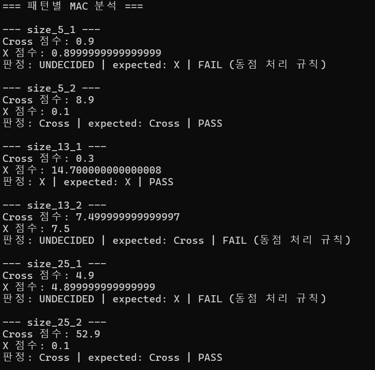
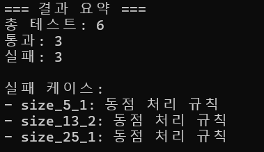
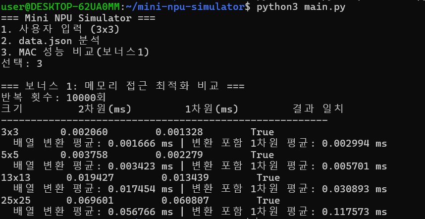

# Mini NPU Simulator

## 1. 프로젝트 소개

Mini NPU Simulator는 Python으로 행렬의 MAC(Multiply-Accumulate) 연산을 구현하고, 입력 패턴이 Cross(+)와 X(x) 중 어느 필터에 더 가까운지 판정하는 프로그램입니다.

3×3 행렬을 직접 입력하는 사용자 입력 모드와 `data.json` 파일을 분석하는 자동 분석 모드를 제공합니다.

또한 행렬 크기에 따른 MAC 연산 시간을 측정하여 연산량과 실행 시간의 관계를 확인합니다.

## 2. 개발 환경

- 운영체제: Windows WSL Ubuntu
- 프로그래밍 언어: Python 3
- 개발 도구: VS Code, Ubuntu 터미널
- 사용 라이브러리: `time`, `json` (Python 표준 라이브러리)

별도의 외부 패키지 설치 없이 실행할 수 있습니다.

## 3. 프로젝트 파일 구성

```text
mini-npu-simulator/
├── main.py
├── data.json
├── README.md
└── screenshots/
```

- `main.py`: MAC 계산, 입력 처리, JSON 분석, 성능 측정 기능
- `data.json`: 크기별 필터와 테스트 패턴 데이터
- `README.md`: 프로젝트 설명 및 실행 결과
- `screenshots/`: 실행 화면 증빙 이미지 저장 폴더

Python이 자동 생성하는 `__pycache__/` 폴더는 프로젝트 실행에 필요한 제출 파일이 아닙니다.

## 4. 실행 방법

Ubuntu 터미널에서 프로젝트 폴더로 이동합니다.

```bash
cd ~/mini-npu-simulator
```

다음 명령어로 프로그램을 실행합니다.

```bash
python3 main.py
```

실행하면 다음 메뉴가 표시됩니다.

```text
=== Mini NPU Simulator ===
1. 사용자 입력 (3x3)
2. data.json 분석
선택:
```

`1`을 입력하면 사용자 입력 모드가, `2`를 입력하면 JSON 자동 분석 모드가 실행됩니다.

## 5. 주요 기능 및 구현 원리

### 5.1 MAC 연산

MAC은 Multiply-Accumulate의 약자로, 곱셈과 누적 덧셈을 수행하는 연산입니다.

입력 패턴과 필터에서 같은 위치에 있는 값을 곱하고, 그 결과를 모두 더하여 점수를 계산합니다.

```python
def calculate_mac(pattern, filter_matrix):
    score = 0.0

    for i in range(len(pattern)):
        for j in range(len(pattern[i])):
            score += pattern[i][j] * filter_matrix[i][j]

    return score
```

- `score = 0.0`: MAC 점수를 저장할 변수를 초기화합니다.
- 바깥쪽 `for`: 행을 순회합니다.
- 안쪽 `for`: 각 행의 열을 순회합니다.
- `pattern[i][j] * filter_matrix[i][j]`: 같은 위치의 원소를 곱합니다.
- `score +=`: 곱셈 결과를 기존 점수에 누적합니다.
- `return score`: 최종 MAC 점수를 반환합니다.

N×N 행렬에서 곱셈은 N²번 수행되므로 시간 복잡도는 O(N²)입니다.

### 5.2 사용자 입력 모드

사용자가 Cross 필터, X 필터, 입력 패턴을 각각 3×3 행렬로 입력합니다.

각 행에는 공백으로 구분한 숫자 3개를 입력해야 합니다.

잘못된 입력은 다시 입력받도록 처리했습니다.

**실제 입력 오류 테스트 결과**

```text
Cross 필터을(를) 입력하세요.
1행: 1 2
오류: 숫자 3개를 입력해야 합니다.
1행: a b c
오류: 숫자만 입력해야 합니다.
1행: 0 1 0
2행: 1 1 1
3행: 0 1 0
```

숫자를 2개만 입력했을 때는 개수 오류가 발생했고, 문자를 입력했을 때는 숫자 형식 오류가 발생했습니다.

두 경우 모두 프로그램이 종료되지 않고 같은 행을 다시 입력받았습니다.

**실제 MAC 계산 결과**

Cross 필터:

```text
0 1 0
1 1 1
0 1 0
```

X 필터:

```text
1 0 1
0 1 0
1 0 1
```

입력 패턴:

```text
0 1 0
1 1 1
0 1 0
```

실행 결과:

```text
Cross MAC 점수: 5.0
X MAC 점수: 1.0
연산 시간(평균/10회): 0.005340 ms
최종 판정: Cross
```

입력 패턴과 Cross 필터의 일치하는 위치에서 곱셈 결과가 누적되어 Cross 점수는 5.0이 되었습니다.

X 필터와의 MAC 점수는 1.0이므로 Cross가 최종 판정되었습니다.

사용자 입력 모드의 시간은 Cross와 X 필터에 대한 MAC 호출을 한 쌍으로 묶어 10회 반복한 평균입니다.

### 5.3 JSON 자동 분석 모드

`data.json`에서 필터와 입력 패턴을 읽어 자동으로 분석합니다.

파일에는 5×5, 13×13, 25×25 크기의 필터와 총 6개의 테스트 패턴이 포함되어 있습니다.

실제 실행 결과:

```text
=== data.json 분석 ===
JSON 파일 로드 성공!
필터 크기: ['size_5', 'size_13', 'size_25']
패턴 개수: 6
```

JSON 파일을 읽을 때 `json.load()`를 사용합니다.

파일이 없거나 JSON 형식이 잘못된 경우에는 예외를 처리하고 오류 메시지를 출력하도록 구현했습니다.

패턴별로 해당 크기의 필터를 선택하고, 행렬 크기와 숫자 형식을 검사한 다음 MAC 점수를 계산합니다.

### 5.4 판정 기준과 epsilon

두 필터의 MAC 점수를 비교하여 다음과 같이 판정합니다.

- Cross 점수가 더 높으면 `Cross`
- X 점수가 더 높으면 `X`
- 두 점수의 차이가 `1e-9`보다 작으면 `UNDECIDED`

```python
if abs(cross_score - x_score) < 1e-9:
    result = "UNDECIDED"
elif cross_score > x_score:
    result = "Cross"
else:
    result = "X"
```

부동소수점 계산에서는 수학적으로 같은 값도 `0.9`와 `0.8999999999999999`처럼 다르게 표현될 수 있습니다.

따라서 작은 차이를 실질적인 동점으로 처리하기 위해 epsilon을 적용했습니다.

JSON의 예상 라벨은 `+`를 `Cross`, `x`를 `X`로 정규화하여 비교합니다.

## 6. JSON 테스트 실행 결과

실제 Ubuntu 환경에서 모드 2를 실행한 결과입니다.

| 테스트 케이스 | Cross 점수 | X 점수 | 판정 | 예상 정답 | 결과 |
|---|---:|---:|---|---|---|
| size_5_1 | 0.9 | 0.9 | UNDECIDED | X | FAIL |
| size_5_2 | 8.9 | 0.1 | Cross | Cross | PASS |
| size_13_1 | 0.3 | 14.7 | X | X | PASS |
| size_13_2 | 7.5 | 7.5 | UNDECIDED | Cross | FAIL |
| size_25_1 | 4.9 | 4.9 | UNDECIDED | X | FAIL |
| size_25_2 | 52.9 | 0.1 | Cross | Cross | PASS |

표의 점수는 읽기 쉽도록 소수점 이하를 반올림해 표시했습니다.

**실제 결과 요약**

```text
=== 결과 요약 ===
총 테스트: 6
통과: 3
실패: 3

실패 케이스:
- size_5_1: 동점 처리 규칙
- size_13_2: 동점 처리 규칙
- size_25_1: 동점 처리 규칙
```

총 6개의 테스트 중 3개가 PASS, 3개가 FAIL로 판정되었습니다.

## 7. FAIL 원인 분석

1. `size_5_1`에서는 Cross 점수가 0.9, X 점수가 약 0.9로 계산되었습니다.
2. 두 점수의 차이가 epsilon보다 작아 `UNDECIDED`로 판정되었습니다.
3. 그러나 예상 정답은 X이므로 FAIL이 발생했습니다.
4. `size_13_2`에서는 Cross 점수가 약 7.5, X 점수가 7.5로 계산되었습니다.
5. 이 경우도 두 점수의 차이가 epsilon보다 작았습니다.
6. 따라서 `UNDECIDED`가 출력되었지만 예상 정답이 Cross여서 FAIL이 발생했습니다.
7. `size_25_1`에서는 Cross 점수가 4.9, X 점수가 약 4.9로 계산되었습니다.
8. 두 필터의 MAC 점수가 사실상 같으므로 `UNDECIDED`가 출력되었습니다.
9. 하지만 예상 정답은 X이므로 FAIL로 기록되었습니다.
10. 세 케이스 모두 프로그램 오류가 아니라 MAC 점수와 동점 처리 기준에 따라 예상 라벨과 다른 결과가 발생한 것입니다.
11. epsilon을 제거하면 매우 작은 부동소수점 차이로 승자가 결정될 수 있습니다.
12. 현재 구현은 이러한 차이를 동점으로 처리하므로 판정 기준을 일관되게 유지합니다.

## 8. 성능 분석

`time.perf_counter()`를 사용하여 MAC 연산 시간을 측정했습니다.

각 크기의 MAC 연산을 10회 반복하고 평균 실행 시간을 밀리초(ms) 단위로 계산했습니다.

파일 읽기나 사용자 입력 시간은 측정 구간에 포함하지 않았습니다.

**실제 측정 결과**

| 행렬 크기 | 평균 연산 시간(ms) | 곱셈 횟수 |
|---|---:|---:|
| 3×3 | 0.002877 | 9 |
| 5×5 | 0.004542 | 25 |
| 13×13 | 0.022827 | 169 |
| 25×25 | 0.066402 | 625 |

측정값은 Ubuntu 환경에서 실행한 한 차례의 결과이며, 시스템 상태에 따라 달라질 수 있습니다.

### 성능 결과 해석

행렬의 크기가 증가할수록 처리해야 할 원소의 개수가 늘어납니다.

3×3 행렬에서는 9번의 곱셈을 수행하지만, 25×25 행렬에서는 625번의 곱셈을 수행합니다.

실제 측정에서도 행렬 크기가 증가함에 따라 평균 실행 시간이 증가하는 경향을 확인했습니다.

이는 이중 반복문을 사용하는 MAC 구현의 O(N²) 시간 복잡도와 일치하는 경향입니다.

다만 짧은 실행 시간은 측정 오차와 시스템 부하의 영향을 받으므로 실행 시간 증가 비율이 정확히 N²에 비례하지는 않습니다.

## 9. 오류 처리 및 검증

프로그램에서 다음 항목을 처리하도록 구현했습니다.

- 3×3 입력에서 숫자 개수가 잘못된 경우
- 숫자 대신 문자를 입력한 경우
- 메뉴에서 1, 2, 3, 4 이외의 값을 입력한 경우
- `data.json` 파일이 없는 경우
- JSON 파일 형식이 잘못된 경우
- `filters` 또는 `patterns` 구조가 올바르지 않은 경우
- 패턴과 필터의 행렬 크기가 일치하지 않는 경우
- 행렬에 숫자가 아닌 값이 포함된 경우
- 예상 정답 라벨을 해석할 수 없는 경우

사용자 입력 오류는 실제 실행으로 확인했습니다. JSON 오류 처리 항목은 코드에 구현된 기능이며, 각각의 오류 상황을 별도로 실행 검증한 결과는 아닙니다.

Python 문법 검사는 다음 명령어로 수행했습니다.

```bash
python3 -m py_compile main.py
```

오류 메시지 없이 검사가 완료되었습니다.

## 10. 실행 결과 캡처

다음은 Ubuntu 환경에서 Mini NPU Simulator를 직접 실행한 결과입니다.

### 10.1 사용자 입력 및 MAC 판정

3×3 Cross 필터, X 필터, 입력 패턴을 직접 입력하고 MAC 점수와 최종 판정을 확인했습니다.


### 10.2 잘못된 입력 처리

숫자 개수가 부족하거나 문자가 입력되었을 때 오류 메시지를 출력하고, 프로그램을 종료하지 않고 다시 입력받는 기능을 확인했습니다.


### 10.3 JSON 자동 분석

`data.json`에서 총 6개 패턴을 읽어 각 패턴의 Cross/X MAC 점수와 PASS/FAIL 판정 결과를 출력했습니다.



### 10.4 크기별 MAC 연산 성능 분석

3×3, 5×5, 13×13, 25×25 행렬의 MAC 연산을 각각 10회 반복하여 평균 실행 시간과 곱셈 횟수를 비교했습니다.


### 10.5 전체 테스트 결과 요약

총 6개 테스트 중 PASS 3개, FAIL 3개가 발생했습니다. 실패한 3개는 모두 epsilon 동점 처리 규칙에 따라 UNDECIDED로 판정된 케이스입니다.



## 11. 프로젝트를 통해 확인한 내용

이번 프로젝트에서는 Python의 이중 반복문으로 MAC 연산을 구현하고, 사용자 입력과 JSON 파일을 통해 서로 다른 크기의 행렬을 처리했습니다.

또한 입력값 검증, 예외 처리, 부동소수점 비교, 자동 테스트 결과 판정, 실행 시간 측정 기능을 구현했습니다.

특히 MAC 점수가 거의 같은 경우에는 부동소수점 표현 차이를 고려해야 한다는 점과, 테스트 결과의 FAIL이 반드시 프로그램 실행 오류를 의미하지는 않는다는 점을 확인했습니다.

## 12. 보너스 1: 메모리 접근 최적화 및 성능 비교

### 12.1 구현 목적

기존 Mini NPU Simulator에서는 2차원 배열과 이중 반복문을 사용하여 MAC(Multiply-Accumulate) 연산을 수행했습니다.

보너스 문제에서는 2차원 배열을 길이 N²의 1차원 배열로 변환하여 메모리 접근 패턴을 단순화하고, 기존 방식과 변경된 방식의 실행 시간을 비교했습니다.

두 방식의 계산 정확성을 유지하면서 배열 구조에 따른 성능 차이를 확인하는 것이 목적입니다.

### 12.2 기존 2차원 MAC 연산

기존 MAC 연산은 다음과 같습니다.

```python
def calculate_mac(pattern, filter_matrix):
    score = 0.0

    for i in range(len(pattern)):
        for j in range(len(pattern[i])):
            score += pattern[i][j] * filter_matrix[i][j]

    return score
```

`pattern[i][j]`와 `filter_matrix[i][j]`를 통해 행과 열의 인덱스를 사용하여 원소에 접근합니다.

각 위치의 값을 곱한 뒤 누적하여 최종 MAC 점수를 반환합니다.

### 12.3 1차원 배열 변환 구현

2차원 배열을 행 단위로 순서대로 읽어 하나의 리스트로 변환하는 `flatten_matrix()` 함수를 구현했습니다.

```python
def flatten_matrix(matrix):
    flat = []

    for row in matrix:
        for value in row:
            flat.append(value)

    return flat
```

예를 들어 다음 3×3 배열을 입력하면,

```text
0 1 0
1 1 1
0 1 0
```

아래와 같이 길이 9의 1차원 배열로 변환됩니다.

```text
[0, 1, 0, 1, 1, 1, 0, 1, 0]
```

배열의 원소 순서는 유지되며, 데이터에 접근하는 방식만 변경됩니다.

### 12.4 1차원 MAC 연산 구현

변환된 배열을 처리하기 위해 `calculate_mac_flat()` 함수를 추가했습니다.

```python
def calculate_mac_flat(flat_pattern, flat_filter):
    score = 0.0

    for k in range(len(flat_pattern)):
        score += flat_pattern[k] * flat_filter[k]

    return score
```

기존 방식에서는 `pattern[i][j]`로 접근하지만, 변경된 방식에서는 `flat_pattern[k]`로 접근합니다.

두 배열의 같은 위치에 있는 원소를 곱하고 결과를 누적하는 MAC 계산 원리는 동일합니다.

### 12.5 MAC 계산 정확성 검증

동일한 3×3 Cross 패턴을 두 방식에 입력하여 계산 결과를 비교했습니다.

실제 실행 결과:

```text
=== MAC 계산 결과 비교 ===
기존 2차원 MAC: 5.0
1차원 MAC: 5.0
변환된 배열: [0, 1, 0, 1, 1, 1, 0, 1, 0]
결과 일치: True
```

기존 2차원 방식과 변경된 1차원 방식 모두 MAC 점수 5.0을 반환했습니다.

이를 통해 테스트한 입력에서 배열 구조를 변경해도 계산 결과가 동일하게 유지되는 것을 확인했습니다.

### 12.6 성능 비교 방법

`compare_mac_performance()` 함수를 구현하여 기존 2차원 MAC과 변경된 1차원 MAC의 실행 시간을 비교했습니다.

측정에는 `time.perf_counter()`를 사용했습니다.

비교 조건은 다음과 같습니다.

- 행렬 크기: 3×3, 5×5, 13×13, 25×25
- 반복 횟수: 각 방식 10,000회
- 입력 데이터: 각 크기에서 동일한 패턴과 필터 사용
- 측정 단위: 1회 평균 실행 시간(ms)
- 정확성 검증: 두 방식의 MAC 점수 비교

1차원 MAC 자체의 실행 시간과 배열 변환에 필요한 시간을 구분하여 측정했습니다.

또한 자동 생성한 Cross 패턴을 성능 비교에 재활용했습니다.

### 12.7 실제 성능 비교 결과

자동 생성한 Cross 패턴을 사용하여 측정한 결과입니다.

```text
=== 보너스 1: 메모리 접근 최적화 비교 ===
반복 횟수: 10000회

크기         2차원(ms)         1차원(ms)         결과 일치
-------------------------------------------------------
3x3       0.003120        0.001770        True
  배열 변환 평균: 0.002447 ms | 변환 포함 1차원 평균: 0.004217 ms

5x5       0.005074        0.003362        True
  배열 변환 평균: 0.003499 ms | 변환 포함 1차원 평균: 0.006861 ms

13x13      0.029388        0.020325        True
  배열 변환 평균: 0.023167 ms | 변환 포함 1차원 평균: 0.043492 ms

25x25      0.095820        0.076036        True
  배열 변환 평균: 0.060262 ms | 변환 포함 1차원 평균: 0.136297 ms
```

성능 비교표:

| 행렬 크기 | 기존 2차원(ms) | 1차원 MAC(ms) | 변환 포함 1차원(ms) | 결과 일치 |
|---|---:|---:|---:|---|
| 3×3 | 0.003120 | 0.001770 | 0.004217 | True |
| 5×5 | 0.005074 | 0.003362 | 0.006861 | True |
| 13×13 | 0.029388 | 0.020325 | 0.043492 | True |
| 25×25 | 0.095820 | 0.076036 | 0.136297 | True |

변환 포함 시간은 배열 변환 평균 시간과 1차원 MAC 평균 시간을 합산한 추정값입니다.

### 12.8 성능 분석

측정 결과, 배열 변환을 제외한 1차원 MAC 연산은 모든 크기에서 기존 2차원 방식보다 빠르게 실행되었습니다.

그러나 배열 변환 시간을 포함한 경우에는 모든 크기에서 기존 방식보다 더 많은 시간이 소요되었습니다.

이는 배열을 한 번 변환한 후 여러 번 재사용하는 상황과, MAC 연산마다 배열을 새로 변환하는 상황에서 최적화 효과가 달라질 수 있음을 보여줍니다.

따라서 단순히 1차원 배열을 사용하는 것만으로 전체 실행 시간이 반드시 감소하는 것은 아닙니다.

또한 Python의 실행 시간은 시스템 부하와 측정 환경에 영향을 받으므로 이번 결과는 해당 실행 환경에서 측정된 값입니다.

### 12.9 실행 결과 캡처

기존 JSON 필터를 사용한 성능 비교 결과입니다.



자동 생성 Cross 패턴을 활용한 성능 비교 결과입니다.


---

## 13. 보너스 2: Cross/X 패턴 자동 생성기

### 13.1 구현 목적

기존 프로그램에서는 사용자가 3×3 패턴을 직접 입력하거나 `data.json`에 저장된 패턴을 사용했습니다.

보너스 문제에서는 행렬 크기 N을 입력하면 N×N 크기의 Cross 패턴과 X 패턴을 자동으로 생성하는 기능을 추가했습니다.

생성한 패턴은 MAC 계산과 성능 분석에 재사용할 수 있도록 구성했습니다.

### 13.2 Cross 패턴 생성 함수

```python
def generate_cross_pattern(n):
    pattern = []

    for i in range(n):
        row = []

        for j in range(n):
            if i == n // 2 or j == n // 2:
                row.append(1)
            else:
                row.append(0)

        pattern.append(row)

    return pattern
```

`n // 2`는 가운데 행과 열의 인덱스를 계산합니다.

현재 프로그램은 3 이상의 홀수 N을 입력받아 가운데 행 또는 가운데 열에 해당하는 위치를 1로 설정합니다.

나머지 위치는 0으로 설정하여 Cross 패턴을 생성합니다.

### 13.3 X 패턴 생성 함수

```python
def generate_x_pattern(n):
    pattern = []

    for i in range(n):
        row = []

        for j in range(n):
            if i == j or i + j == n - 1:
                row.append(1)
            else:
                row.append(0)

        pattern.append(row)

    return pattern
```

`i == j`는 왼쪽 위에서 오른쪽 아래로 이어지는 대각선 위치를 의미합니다.

`i + j == n - 1`은 오른쪽 위에서 왼쪽 아래로 이어지는 대각선 위치를 의미합니다.

두 조건 중 하나를 만족하면 1을 저장하고, 그렇지 않으면 0을 저장합니다.

### 13.4 패턴 크기 입력 및 오류 처리

`run_pattern_generator()` 함수에서 사용자에게 패턴 크기 N을 입력받습니다.

```python
while True:
    try:
        n = int(input("패턴 크기 N 입력 (3 이상의 홀수): "))

        if n < 3 or n % 2 == 0:
            print("오류: 3 이상의 홀수를 입력하세요.")
            continue

        break

    except ValueError:
        print("오류: 정수를 입력하세요.")
```

입력값이 3 미만이거나 짝수인 경우 다시 입력받도록 구현했습니다.

정수가 아닌 값이 입력되면 오류 메시지를 출력하도록 처리했습니다.

### 13.5 5×5 패턴 생성 예시

N에 5를 입력하면 다음과 같은 패턴을 생성합니다.

Cross 패턴:

```text
0 0 1 0 0
0 0 1 0 0
1 1 1 1 1
0 0 1 0 0
0 0 1 0 0
```

X 패턴:

```text
1 0 0 0 1
0 1 0 1 0
0 0 1 0 0
0 1 0 1 0
1 0 0 0 1
```

두 패턴 모두 5×5 크기로 생성되며, 각 패턴의 형태에 해당하는 위치에 1이 저장됩니다.

### 13.6 생성 패턴의 MAC 계산 재활용

생성된 Cross 패턴을 입력으로 사용하고, Cross와 X 패턴을 각각 필터로 사용하여 MAC 점수를 계산하도록 구현했습니다.

```python
cross_pattern = generate_cross_pattern(n)
x_pattern = generate_x_pattern(n)

cross_score = calculate_mac(cross_pattern, cross_pattern)
x_score = calculate_mac(cross_pattern, x_pattern)
```

5×5 Cross 입력 패턴의 예상 계산 결과는 다음과 같습니다.

```text
=== 생성 패턴 MAC 테스트 ===
입력 패턴: Cross
Cross 필터 점수: 9.0
X 필터 점수: 1.0
최종 판정: Cross
```

Cross 필터는 입력 Cross 패턴과 9개 위치에서 일치하여 점수 9.0을 얻습니다.

X 필터와는 중앙 위치 1개가 겹치므로 점수 1.0을 얻습니다.

따라서 최종 판정은 Cross입니다.

### 13.7 성능 분석에 자동 생성 패턴 재활용

보너스 1의 `compare_mac_performance()` 함수에서도 자동 생성 함수를 사용하도록 연결했습니다.

```python
test_matrices = []

for size in [3, 5, 13, 25]:
    cross_pattern = generate_cross_pattern(size)
    test_matrices.append((size, cross_pattern))
```

이를 통해 `data.json`에서 테스트 행렬을 읽지 않고도 원하는 크기의 Cross 패턴을 생성하여 성능 분석에 사용할 수 있습니다.

기존 JSON 분석 모드는 별도로 유지했습니다.

### 13.8 실행 방법

Ubuntu 터미널에서 다음 명령어를 실행합니다.

```bash
python3 main.py
```

메뉴에서 4번을 선택합니다.

```text
=== Mini NPU Simulator ===
1. 사용자 입력 (3x3)
2. data.json 분석
3. MAC 성능 비교(보너스1)
4. 패턴 자동 생성(보너스2)
선택: 4
```

패턴 크기에 5를 입력하면 Cross/X 패턴을 자동으로 생성하고 MAC 점수와 최종 판정을 출력합니다.

### 13.9 실행 결과 캡처


---

## 14. 보너스 문제 구현 결과 정리

보너스 1에서는 2차원 배열을 1차원 배열로 변환하는 기능을 구현하고, 두 방식의 MAC 계산 정확성과 실행 시간을 비교했습니다.

실제 측정에서는 1차원 MAC 자체의 실행 시간이 더 짧았지만, 배열 변환 시간을 포함하면 기존 방식보다 더 오래 걸렸습니다.

이를 통해 최적화 성능을 평가할 때 연산 시간뿐 아니라 데이터 변환 비용도 고려해야 한다는 점을 확인했습니다.

보너스 2에서는 입력받은 크기에 따라 Cross/X 패턴을 자동으로 생성하고, 생성된 패턴을 기존 MAC 계산과 성능 분석에 재활용하도록 구현했습니다.

기존 사용자 입력 모드와 JSON 분석 모드는 유지하면서 기능을 확장했습니다.